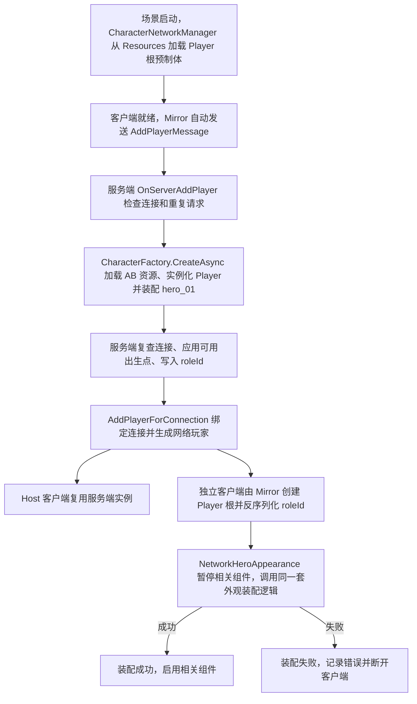

# 角色生成与运行时组装

当前联机场景是 `TestScene`。角色由通用的 `Player` 网络根对象、`hero_01` 的模型与骨骼、共用的 `weapon_01_prefab` 三部分组成。服务端装配完毕后生成网络玩家，独立客户端根据同步到的 `roleId` 从本地资源重建模型、武器和 IK。Host 的客户端侧共用服务端已经装配好的实例。 [场景配置](../Assets/Scenes/TestScene.unity) · [角色工厂](../Assets/Scripts/GamePlay/CharacterFactory.cs)

## 角色生成流程图



1. **注册玩家根预制体。** 场景的 `NetworkManager` 对象同时挂载 `CharacterNetworkManager` 和 `CharacterFactory`。`playerPrefab` 在场景里留空，由 `CharacterNetworkManager.Awake()` 通过 `Resources.Load<GameObject>("Prefabs/Player")` 填入。Mirror 在启动客户端时注册这份预制体，收到生成消息后可按 `assetId` 找到它。 [场景配置](../Assets/Scenes/TestScene.unity) · [CharacterNetworkManager.cs](../Assets/Scripts/Net/CharacterNetworkManager.cs) · [Mirror NetworkManager.cs](../Assets/Mirror/Core/NetworkManager.cs)
2. **服务端创建并生成玩家。** `autoCreatePlayer` 已开启，Mirror 在连接后或在线场景加载完成后使客户端就绪并请求添加玩家。`OnServerAddPlayer` 用 `connection.identity` 和 `pendingPlayers` 拦截重复请求，再调用 `CharacterFactory.CreateAsync("hero_01")`。装配完成后复查连接是否仍有效，有可用的 Mirror 出生点时应用其位置和旋转，否则保留实例原位姿。服务端随后把 `hero_01` 写入 `NetworkHeroAppearance.roleId`，再调用 `NetworkServer.AddPlayerForConnection` 绑定连接、设置所有权并触发网络生成。组装或登记失败会清理已创建且未登记的玩家实例。 [CharacterNetworkManager.cs](../Assets/Scripts/Net/CharacterNetworkManager.cs) · [Mirror NetworkServer.cs](../Assets/Mirror/Core/NetworkServer.cs)
3. **独立客户端装配外观。** Mirror 先实例化已注册的 `Player`，再反序列化生成消息里的 `roleId` 同步变量。`NetworkHeroAppearance` 可由该变量的 hook 或 `OnStartClient` 触发装配，同一角色 ID 正在装配或已经装配时会跳过重复调用。这条路径覆盖本地玩家和客户端看到的其他玩家。Host 上的玩家实例已由服务端装配，客户端回调中的 `isServer` 检查会跳过这一步。 [Mirror NetworkClient.cs](../Assets/Mirror/Core/NetworkClient.cs) · [NetworkHeroAppearance.cs](../Assets/Scripts/GamePlay/NetworkHeroAppearance.cs)

## 运行时组装

### 资源和预制体分工

| 资源 | 获取方式 | 装配前已有的内容 |
| --- | --- | --- |
| `Player.prefab` | `Resources/Prefabs/Player` | 根节点上的 `NetworkIdentity`、`NetworkTransformHybrid`、`NetworkAnimator`、`Animator`、`RigBuilder` 和玩法组件。`Animator` 已引用共用的 `Player.controller`，Avatar 和 Rig 引用留待运行时填入。 [预制体](../Assets/Resources/Prefabs/Player.prefab) · [动画控制器](../Assets/GameAssets/Animations/PlayerAnims/Player.controller) |
| `HeroCatalog` 和 `hero_01_prefab` | AssetBundle `heros` | 工厂从包中读取目录，按 `roleId` 查到外观预制体及模型 Avatar。外观预制体包含模型、骨骼和左手 Rig，`HeroVisualBinding` 暴露 Rig、左手约束和右手武器挂点。 [角色目录](../Assets/GameAssets/Heros/HeroCatalog.asset) · [外观预制体](../Assets/GameAssets/Heros/hero_01/hero_01_prefab.prefab) |
| `weapon_01_prefab` | AssetBundle `weapons` | 工厂统一使用的武器外观。`WeaponVisualBinding` 暴露左手 IK 目标、站立／行走姿势和奔跑姿势，以及可选的 `FirePoint`。 [武器预制体](../Assets/GameAssets/Weapons/weapon_01/weapon_01_prefab.prefab) · [WeaponVisualBinding.cs](../Assets/Scripts/GamePlay/WeaponVisualBinding.cs) |

`CharacterFactory` 首次创建或装配角色时并行加载 `heros` 和 `weapons`，再读取目录和武器预制体。同一会话中的多个玩家共享资源加载任务，每个玩家分别实例化自己的模型和武器。包文件由 `AssetBundleManager` 从 `Application.streamingAssetsPath/PC/` 读取，网络端停止时由工厂释放包引用并使该会话的在途工作失效。 [CharacterFactory.cs](../Assets/Scripts/GamePlay/CharacterFactory.cs) · [AB 包管理器](AB包管理器.md)

### 对象层级

以下为 `hero_01` 装配后的关键节点，省略了中间骨骼和渲染节点。

```text
Player                                  根节点承载网络、玩法、Animator 和 RigBuilder
└─ hero_01_prefab                        HeroVisualBinding
   ├─ Rig
   │  ├─ LeftHandIK                     TwoBoneIKConstraint
   │  └─ LeftElbowHint
   └─ Armature
      └─ … → R_Hand
              └─ Point                  HeroVisualBinding.WeaponMount
                 └─ weapon_01_prefab    WeaponVisualBinding
                    └─ Weapon
                       ├─ LeftHandIKTarget
                       ├─ LeftHandIdleWalkPose
                       └─ LeftHandRunPose
```

### 绑定顺序

1. **补齐动画引用。** `AssembleAppearanceAsync` 校验角色目录项和根组件，把角色 Avatar 赋给根节点的 `Animator`。随后让 `NetworkAnimator` 指向同一个 `Animator` 并重新启用它，再用 `AnimComp_1001.InitializeAnimator` 初始化动画参数。 [CharacterFactory.cs](../Assets/Scripts/GamePlay/CharacterFactory.cs) · [AnimCompBase.cs](../Assets/Scripts/GamePlay/Player/Components/AnimCompBase.cs)
2. **挂载外观和武器。** 在 `Player` 下实例化角色外观，从 `HeroVisualBinding.WeaponMount` 取得右手骨骼下的 `Point`，再把武器实例化为 `Point` 的子节点。武器随右手骨骼运动。 [CharacterFactory.cs](../Assets/Scripts/GamePlay/CharacterFactory.cs) · [HeroVisualBinding.cs](../Assets/Scripts/GamePlay/HeroVisualBinding.cs)
3. **接通左手 IK 和武器控制器。** 外观预制体已配置左臂骨骼链和肘部提示点，约束的 `target` 在预制体中为空。工厂把它指向武器实例上的 `LeftHandIKTarget`，将角色 Rig 加入根节点的 `RigBuilder.layers`，并把 Rig、目标及两种姿势注入 `Controller_1001`。控制器将目标放到站立／行走姿势，运行时逐步提高 Rig 权重，并按奔跑状态在两个姿势间插值。`WeaponController.InitializeWeapon` 接收武器的 `FirePoint`。当前武器预制体的这个字段为空，控制器会回退到角色根位置加胸口高度偏移。 [CharacterFactory.cs](../Assets/Scripts/GamePlay/CharacterFactory.cs) · [Controller_1001.cs](../Assets/Scripts/GamePlay/Player/Controller/Controller_1001.cs) · [WeaponController.cs](../Assets/Scripts/GamePlay/Weapon/WeaponController.cs)
4. **重绑并完成装配。** 等模型、骨骼和约束引用就位后，依次执行 `Animator.Rebind()` 和 `RigBuilder.Build()`，再记录已装配的角色 ID。独立客户端等待期间禁用 `MoveComp`、`AnimComp_1001`、`Controller_1001`、`WeaponController` 和 `CameraComp`，装配成功且 ID 一致时重新启用。装配失败会记录错误并断开该客户端。 [CharacterFactory.cs](../Assets/Scripts/GamePlay/CharacterFactory.cs) · [NetworkHeroAppearance.cs](../Assets/Scripts/GamePlay/NetworkHeroAppearance.cs)
