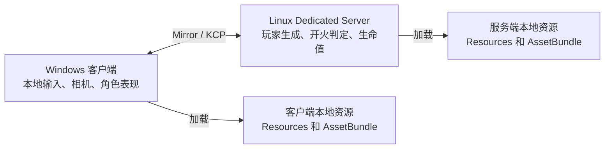
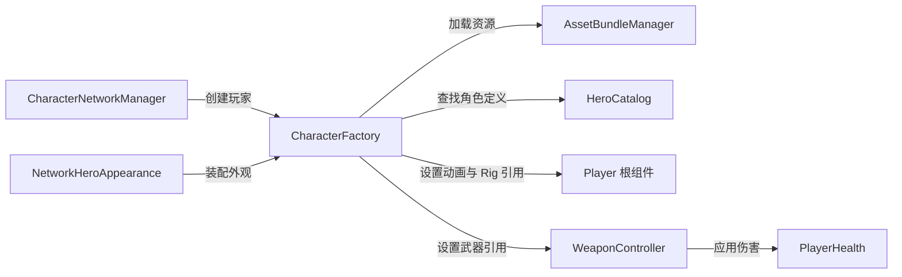

# FPSGame-Y1 项目架构与模块介绍

## 1. 项目概览

FPSGame-Y1 是使用 Unity 6（`6000.3.6f1`）和 C# 开发的多人联机游戏项目。Mirror 提供网络对象、所有权和状态同步，KCP 负责传输，Animation Rigging 用于角色持握姿势，AssetBundle 用于加载角色与武器外观。 [Unity 版本](../ProjectSettings/ProjectVersion.txt) · [Unity 依赖](../Packages/manifest.json)

| 入口 | 用途 |
| --- | --- |
| `TestScene` | 当前启用的构建场景，包含 `CharacterNetworkManager`、`CharacterFactory`、`KcpTransport`、`NetworkManagerHUD` 和场景相机。 [场景](../Assets/Scenes/TestScene.unity) · [构建设置](../ProjectSettings/EditorBuildSettings.asset) |
| `ResTestDemo` | 在编辑器中验证资源相关功能的辅助场景。 [场景](../Assets/Scenes/ResTestDemo.unity) |

## 2. 总体架构

### 客户端与服务端

编辑器中的 Host 在同一进程运行服务端和本地客户端，两侧共用服务端生成的角色实例。独立客户端从自己的本地资源装配角色外观。 [角色生成与运行时组装](角色生成与运行时组装.md)

### 网络所有权与状态同步

| 状态或操作 | 驱动端 | 同步方式 |
| --- | --- | --- |
| 角色 ID | 服务端在生成玩家前设定 `roleId` | `NetworkHeroAppearance` 的 `SyncVar` 随玩家状态同步给客户端。 [组件](../Assets/Scripts/GamePlay/NetworkHeroAppearance.cs) |
| 位置与旋转 | 拥有角色的客户端运行 `MoveComp` | `NetworkTransformHybrid` 配置为 `ClientToServer`，由服务端向其他客户端转发。 [移动组件](../Assets/Scripts/GamePlay/Player/Components/MoveComp.cs) · [Player 预制体](../Assets/Resources/Prefabs/Player.prefab) |
| 动画 | 拥有角色的客户端驱动动画参数与开火触发器 | `NetworkAnimator` 配置为 `ClientToServer`，同步动画参数和触发器。 [角色控制器](../Assets/Scripts/GamePlay/Player/Controller/Controller_1001.cs) · [动画组件](../Assets/Scripts/GamePlay/Player/Components/AnimCompBase.cs) · [Player 预制体](../Assets/Resources/Prefabs/Player.prefab) |
| 开火与伤害 | 本地所有者提交点击时的角色偏航，服务端重建枪口路径并结算伤害 | `WeaponController.CmdFire` 是 Mirror `Command`。服务端生成表现子弹，各端沿同步路径推进。 [武器控制器](../Assets/Scripts/GamePlay/Weapon/WeaponController.cs) · [子弹](../Assets/Scripts/GamePlay/Weapon/Bullet.cs) |
| 生命值 | 服务端初始化和修改 | `PlayerHealth.health` 通过 `SyncVar` 同步，变化时触发 `HealthChanged`。 [生命值组件](../Assets/Scripts/GamePlay/Player/PlayerHealth.cs) |
| 相机与左手 IK | 相机由本地拥有者控制，左手 IK 由各端根据动画状态计算 | 相机位姿与 IK 目标由本端组件更新。 [相机组件](../Assets/Scripts/GamePlay/Camera/CameraComp.cs) · [角色控制器](../Assets/Scripts/GamePlay/Player/Controller/Controller_1001.cs) |

### 模块依赖

箭头表示调用或引用。

## 3. 核心模块

### 网络管理

`CharacterNetworkManager` 扩展 Mirror 的 `NetworkManager`，加载玩家根预制体，受理添加玩家请求，并把装配好的玩家交给 Mirror 绑定连接和分配所有权。`NetworkAddressConfig` 按命令行参数、环境变量、持久化配置文件的顺序查找地址覆盖，最后回退到场景配置。端口由场景上的 `KcpTransport` 配置。 [CharacterNetworkManager.cs](../Assets/Scripts/Net/CharacterNetworkManager.cs) · [NetworkAddressConfig.cs](../Assets/Scripts/Net/NetworkAddressConfig.cs)

### 角色生成与外观组装

`Player.prefab` 提供网络身份和通用玩法组件。`CharacterFactory` 通过 `HeroCatalog` 查找角色外观和 Avatar，通过 `HeroVisualBinding` 与 `WeaponVisualBinding` 获取武器挂点和左手 IK 引用。当前联机入口使用 `hero_01` 和共用的 `weapon_01_prefab`。`NetworkHeroAppearance` 保存同步的角色 ID，并触发独立客户端装配。 [CharacterFactory.cs](../Assets/Scripts/GamePlay/CharacterFactory.cs) · [HeroCatalog.asset](../Assets/GameAssets/Heros/HeroCatalog.asset) · [角色生成与运行时组装](角色生成与运行时组装.md)

### 玩家控制与表现

| 组件 | 职责 |
| --- | --- |
| `MoveComp` | 将本地鼠标光标投影到枪口高度的水平面，按枪管方向和枪口偏移计算角色的水平朝向，根据按键更新前进速度。无枪口时使用角色脚下的平面。 [脚本](../Assets/Scripts/GamePlay/Player/Components/MoveComp.cs) |
| `Controller_1001` | 将移动状态写入动画组件，根据奔跑状态调整左手 IK 姿势。 [脚本](../Assets/Scripts/GamePlay/Player/Controller/Controller_1001.cs) |
| `AnimComp_1001` / `AnimCompBase` | 为根节点上的 Animator 设置 `Speed`、`IsRunning` 和 `Shoot` 参数。 [动画基类](../Assets/Scripts/GamePlay/Player/Components/AnimCompBase.cs) · [Player.controller](../Assets/GameAssets/Animations/PlayerAnims/Player.controller) |
| `CameraComp` | 为本地拥有者驱动场景中的 `Main Camera`，从固定视角跟随角色。 [脚本](../Assets/Scripts/GamePlay/Camera/CameraComp.cs) |

鼠标控制角色朝向，松开 W 时可原地转身。按住 W 行走，加按左 Shift 奔跑。行走和奔跑时，角色沿当前朝向持续前进，同时平滑转向光标。 [移动组件](../Assets/Scripts/GamePlay/Player/Components/MoveComp.cs)

### 武器与生命值

枪随角色根节点水平转动，持枪俯仰由动画提供。`WeaponController` 提交点击时的根节点偏航，服务端据此调整用于该发的枪口位置与枪管方向，并在武器射程内查询第一处有效碰撞。命中 `PlayerHitbox` 时由 `PlayerHealth` 结算伤害，场景碰撞会阻断射击。`WeaponStats` 提供伤害、开火间隔和射程的默认配置。`Bullet` 负责飞行表现，服务端管理其销毁时机。 [武器控制器](../Assets/Scripts/GamePlay/Weapon/WeaponController.cs) · [碰撞查询](../Assets/Scripts/GamePlay/Weapon/ShotCollision.cs) · [武器参数](../Assets/Scripts/Shared/Config/WeaponStats.cs) · [生命值](../Assets/Scripts/GamePlay/Player/PlayerHealth.cs)

### 资源管理

- **Resources** · `Player.prefab` 和 `Bullet.prefab` 是网络对象的基础资源。`CharacterNetworkManager` 在运行时加载玩家预制体，子弹预制体在场景的 `spawnPrefabs` 中注册。 [Player 预制体](../Assets/Resources/Prefabs/Player.prefab) · [Bullet 预制体](../Assets/Resources/Prefabs/Bullet.prefab) · [场景配置](../Assets/Scenes/TestScene.unity)
- **AssetBundle** · `heros` 包提供角色目录与外观，`weapons` 包提供共用武器外观。`CharacterFactory` 按会话共享加载任务，网络端停止时释放包引用。`AssetBundleManager` 管理本地包加载、依赖、缓存和引用计数。 [CharacterFactory.cs](../Assets/Scripts/GamePlay/CharacterFactory.cs) · [AB包管理器](AB包管理器.md)

## 4. 目录与代码入口

### 目录导航

| 目录 | 内容 |
| --- | --- |
| `Assets/Scripts/Net` | 项目网络管理和连接地址配置 |
| `Assets/Scripts/GamePlay` | 角色、移动、动画、相机、武器和生命值 |
| `Assets/Scripts/Res` | AssetBundle 管理和资源相关代码 |
| `Assets/Scripts/Shared/Config` | 玩法配置，目前提供 `WeaponStats` |
| `Assets/GameAssets`、`Assets/Resources` | 项目模型、动画、外观资源以及 `Resources` 直接加载的预制体 |
| `Assets/Scenes`、`ProjectSettings`、`Packages` | 场景、构建设置和 Unity 包依赖 |
| `Assets/Mirror` | 仓库内置的 Mirror 源码、传输和示例 |
| `Assets/Editor`、`Tools/deploy` | Unity 构建菜单与部署脚本 |

### 常见改动入口

| 改动 | 从哪里开始 |
| --- | --- |
| 增加角色外观 | 在 `HeroCatalog` 配置角色 ID、外观和 Avatar。联机入口的默认角色 ID 由 `CharacterNetworkManager` 指定。 [角色目录](../Assets/GameAssets/Heros/HeroCatalog.asset) · [网络管理器](../Assets/Scripts/Net/CharacterNetworkManager.cs) |
| 调整移动、转向或相机 | 在 `Player.prefab` 的 `MoveComp` 调整走跑速度和转速，在 `CameraComp` 配置相机偏移。 [Player 预制体](../Assets/Resources/Prefabs/Player.prefab) |
| 调整武器伤害和开火间隔 | 查看 `WeaponStats` 的默认值和 `WeaponController` 的使用位置。 [WeaponStats.cs](../Assets/Scripts/Shared/Config/WeaponStats.cs) · [武器控制器](../Assets/Scripts/GamePlay/Weapon/WeaponController.cs) |
| 切换服务端地址 | 启动客户端时使用 `-serverAddr`，或通过 Unity 的 `Tools > FPSGame-Y1` 菜单切换场景默认地址。 [地址配置](../Assets/Scripts/Net/NetworkAddressConfig.cs) · [出包工具](../Assets/Editor/FPSGameBuildWindow.cs) |

## 5. 构建与验证

- **本地运行** · 在 Unity 中打开 `TestScene`，通过 `NetworkManagerHUD` 启动 Host，或启动独立客户端连接测试服务端。资源验证场景为 `ResTestDemo`，Unity 测试入口为 `Window > General > Test Runner`。 [仓库开发说明](../AGENTS.md)
- **AssetBundle** · Unity 菜单 `Tools > Build AssetBundles` 将包写入 `Assets/StreamingAssets/PC/`。 [构建脚本](../Assets/Editor/BuildAssetBundles.cs)
- **客户端和服务端出包** · `Tools > FPSGame-Y1` 提供 Windows 客户端和 Linux Dedicated Server 的出包入口，输出分别位于 `Build/WindowsClient/` 和 `Build/LinuxServer/`。单独的发布文档记录了部署与验收步骤。 [出包工具](../Assets/Editor/FPSGameBuildWindow.cs) · [出包与发布流程](Skills/出包与发布流程.md)
